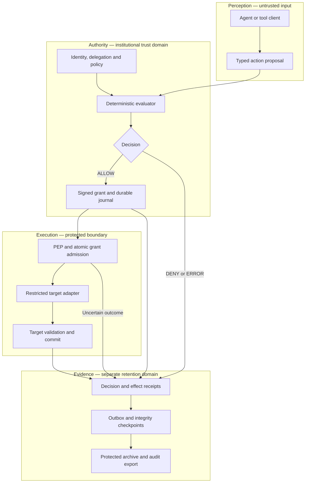
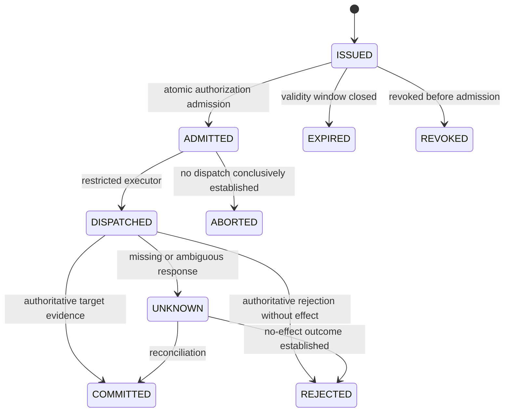

# REX Guard — Auditable Authority for AI-Initiated Actions

**A reference architecture for deterministic authorization, controlled execution, and verifiable evidence.**

Alex Bolson · Founder & Chief Architect, FoundLab

Public architecture portfolio · v1.0 · October 2026

[Rights and reuse](LICENSE) · [Publication boundaries](PUBLICATION_POLICY.md) · [Security](SECURITY.md) · [Feedback](CONTRIBUTING.md)

> **Scope:** This document presents a proposed architecture and its engineering rationale. Diagrams describe intended control flows. Examples are illustrative; acceptance scenarios are specifications, not reported test results. Deployment status, performance, and regulatory compliance are outside this document's claims.

## The engineering problem

An AI agent can propose a valid-looking business operation without possessing the authority to perform it.

Schema validation does not establish delegation. An authenticated workload is not automatically authorized to move a customer's funds. A policy decision does not prove that a downstream transaction committed.

REX Guard addresses this boundary through four distinct responsibilities:

| Phase | Responsibility | Required artifact |
|---|---|---|
| Perception | Convert untrusted input into a typed action proposal | Validated proposal |
| Authority | Evaluate institutional authority using explicit facts and deterministic policy | Decision and bounded execution grant |
| Execution | Enforce the grant at the point that can produce the effect | Admitted operation and authoritative outcome |
| Evidence | Preserve attributable records of the decision and observed outcome | Signed receipts and independently checkable integrity proofs |

This composition is referred to here as **Auditable Trust Infrastructure — ATI**. It is an architectural model, not a claim of an industry standard or certification.

**Central invariant:** an AI-originated proposal must not reach a protected side effect without operation-specific authority enforced by a boundary the caller cannot bypass.

## Architecture



The diagram describes logical boundaries. It does not require a microservice for every box. The simplest deployment that preserves credential isolation, durable authority state, and enforcement is preferable.

### Hot path and cold path

The hot path authenticates the caller, resolves authoritative context, evaluates policy, seals and records the decision, admits the grant, and invokes the target.

The cold path publishes policy and trust material, reconciles uncertain outcomes, delivers evidence, builds integrity checkpoints, and prepares audit packages.

The cold path is asynchronous, not optional. Before releasing an actionable grant, the hot path must preserve enough durable state to recover safely. Archive and indexing lag require explicit bounds and backpressure.

## Threat model and trust boundaries

The design considers malicious or compromised agents, prompt injection, forged context, cross-tenant requests, replay, concurrent redemption, stale executors, partial failures, and evidence tampering.

| Boundary | Trusted for | Not trusted for |
|---|---|---|
| LLM and agent | Producing candidate proposals | Granting institutional authority |
| Identity provider | Authenticating identities within its trust domain | Authorizing every business action |
| Policy authority | Publishing approved rules and delegation constraints | Confirming downstream transaction effects |
| Enforcement service | Admitting and dispatching the exact authorized operation | Declaring commit without target evidence |
| Target system | Enforcing its business invariants and reporting its committed state | Proving the integrity of an external audit archive |
| Signing service | Signing supplied bytes with a controlled key | Establishing the factual truth of those bytes |
| Audit archive | Retaining evidence under configured controls | Demonstrating that every real-world event was recorded |

The architecture does not claim resistance to simultaneous compromise of every authority, signing key, and target. Administrative separation and independently retained checkpoints reduce the extent to which one operator can rewrite the available evidence.

## 1. Perception: proposals carry no authority

LLMs, IDE integrations, MCP clients, and external orchestrators are untrusted callers. A model response can suggest a tool and arguments; it cannot establish tenant membership, invent a delegation, or approve its own transaction.

The ingress performs strict parsing, size limits, action allowlisting, and domain validation. Tenant, subject, delegation, and approved purpose are resolved from authenticated institutional sources.

```json
{
  "schema": "ati.action-proposal/1",
  "request_id": "example-request",
  "action": "payments.create/1",
  "target_ref": "example-core",
  "resource_ref": "opaque-account-reference",
  "parameters": {
    "amount_minor": "10000",
    "currency": "BRL",
    "beneficiary_ref": "opaque-beneficiary-reference"
  },
  "claimed_purpose": "supplier_payment",
  "idempotency_key": "example-operation"
}
```

This proposal is not a payment instruction with executable authority. Monetary values use strings representing integer minor units under a declared currency and scale. Ambiguous amounts, unknown tools, or missing institutional facts stop the flow.

Sensitive context is minimized before model access. Model-provider logging, retention, caching, and optional features are separate controls; selecting an enterprise endpoint does not establish a complete zero-retention property. The selected integration must be checked against its current provider conditions. [1]

## 2. Authority: deterministic evaluation and bounded grants

### Gate Zero

The authority evaluator receives a normalized proposal, authenticated identities, explicit facts, a policy version, and an evaluation time. Equivalent inputs must produce equivalent authorization decisions and reason codes.

The evaluator must not invoke an LLM to decide authority. A probabilistic risk signal can be a versioned input to a deterministic rule, but cannot independently create delegation or privilege.

Missing policy, expired delegation, unavailable mandatory context, invalid identity, or excessive clock uncertainty blocks new authorization. Cached policy is usable only while its declared validity and freshness remain satisfied.

### Capability boundary

An approved decision yields a short-lived, holder-bound execution grant. Its binding covers:

- Issuer, audience, caller, subject, tenant, and delegation.
- Approved purpose, target, resource, action, and exact parameters.
- Policy version and relevant revocation epoch.
- Required approvals and execution preconditions.
- Validity interval, operation binding, and idempotency key.
- A unique grant identifier and a single-use restriction.

A signature protects this binding from undetected modification. It does not make the grant unlimited or prove that its policy is correct.

Signature verification requires an authenticated trust bundle, an approved algorithm, an authorized key version, and an unambiguous signed representation. A JSON signature profile can use RFC 8785 canonicalization, strict parsing, and explicit domain separation. Duplicate property names must be rejected before parsers silently discard them. [2]

A Google Cloud mapping can use Cloud KMS with `EC_SIGN_P256_SHA256`; verification uses the corresponding public key. Policy validation remains application logic. Key administration, capability signing, and receipt signing should have separate privileges and roles. [3]

### Single-use is a distributed-state property

A cryptographically random nonce does not prevent two instances from accepting the same grant.

Grant admission requires a durable, linearizable transition from issued to admitted, with a unique constraint over its institutional scope. The transition records the operation and its dispatch intent atomically. In-process maps, sticky sessions, and cache TTLs do not satisfy this requirement.

Idempotency is separate: the same business operation, even presented with another grant, must not receive another effect. Reusing an idempotency key with a different operation binding is a conflict.

The admission point defines the authorization boundary. If revocation must remain effective until the target's actual commit, the target must participate in a stronger coordinated check; checking only at the gateway cannot establish that property.

## 3. Execution: enforcement and outcome are separate

### An enforcement point must be mandatory

The Policy Enforcement Point — PEP — validates the grant, authenticated holder, operation binding, temporal conditions, and authoritative admission state before dispatch.

The agent has no target credential. The target accepts the restricted executor identity rather than the agent identity. A policy callback that a caller can ignore is advisory; it is not an enforced execution boundary.

Local target checks remain mandatory. Account state, balance, business limits, concurrency preconditions, and applicable approvals must be evaluated at the target's transactional boundary when they can change after authorization.

### Three integration modes

These modes describe integration contracts, not a declaration of released product features.

| Mode | Authority and execution split | Required control |
|---|---|---|
| Guard | REX evaluates; the institution executes | A mandatory institutional PEP enforces the operation-bound decision |
| Capability | The caller presents a bounded grant to a registered tool | The tool validates and consumes the grant before producing an effect |
| Operator | A restricted REX adapter executes on the caller's behalf | Target credentials remain inside the executor boundary |

All modes share the same authority, binding, replay, and evidence requirements. Hiding a tool in the model's UI is not a substitute for server-side enforcement.

### Failure semantics

**ALLOW is not COMMITTED. A timeout is not proof of failure.**



An admitted grant never returns to issued. Losing a worker lease does not restore authority. If ownership can transfer, fencing must be checked where the effect can occur; a journal-only fence cannot stop a stale worker from calling an unprotected external API.

| Failure | Required behavior |
|---|---|
| Parsing, identity, policy, or operation-binding failure | No dispatch |
| Mandatory signing or authority-state dependency unavailable | No new actionable grant or admission |
| Connection fails before dispatch is conclusively attempted | Preserve the existing operation and its state |
| Response lost after possible target acceptance | Record UNKNOWN and reconcile |
| Target supports reliable idempotent replay | Retry only under that documented contract, using the same operation identity |
| Target lacks adequate idempotency or fencing | No automatic retry of ambiguous dispatch |
| Evidence delivery unavailable within approved bounds | Retain durable outbox state and report lag |
| Evidence backlog exceeds approved limits | Stop new admissions for the affected route |

Fail-closed controls new admission and dispatch. It cannot undo a transaction the target has already accepted. Compensation is a new authorized operation, not deletion of the original event.

There is no assumed distributed transaction between the authority journal and an external core. An end-to-end exactly-once claim requires additional target-specific proof.

## 4. Evidence: prove only what the record supports

### DecisionReceipt and EffectReceipt

The evidence layer — Veritas Protocol in this design — separates two records:

| Record | What it captures | What it does not establish alone |
|---|---|---|
| DecisionReceipt | Authority context, operation binding, policy version, decision, and reason codes | That the target executed or committed |
| EffectReceipt | Observed outcome, source, target reference, and correlation to the decision | Independent truth of the target state unless supported by target evidence |

Each logical decision has a stable DecisionID. Every receipt has a distinct record ID. Resolving UNKNOWN creates a new linked receipt; it never rewrites the earlier observation.

An illustrative evidence payload:

```json
{
  "schema": "ati.effect-receipt-payload/1",
  "record_id": "example-effect-record",
  "decision_id": "example-decision",
  "operation_id": "example-operation",
  "decision_receipt_ref": "example-decision-record",
  "operation_commitment": "<opaque-cryptographic-binding>",
  "policy_ref": "example-policy-version",
  "outcome": {
    "status": "UNKNOWN",
    "target_ref": "example-core",
    "source_type": "ADAPTER_OBSERVATION",
    "reason": "TARGET_RESPONSE_NOT_OBSERVED"
  },
  "observed_at": "2026-10-18T00:00:00Z"
}
```

This is a payload sketch, not an executable signature format or real transaction record. A concrete signed envelope must cover all interpretation-critical fields, including schema, domain, algorithm, key version, and payload.

A signature attributes a declaration to a key under a trust policy. It does not certify the declaration's factual accuracy, provide an independent event timestamp, or automatically establish legal non-repudiation.

### Merkle integrity and independent checkpoints

Receipts can be incorporated into an ordered Merkle log with signed checkpoints. RFC 9162 supplies a defined construction for leaf/node domain separation and inclusion/consistency proofs; using those algorithms does not make this architecture a Certificate Transparency implementation. [4]

Inclusion proves membership relative to a trusted root. Detecting truncation or conflicting histories requires earlier checkpoints or an independent witness. A root supplied only by the potentially compromised archive is insufficient.

Durable receipt publication precedes checkpoint advancement. Failed signing leaves a pending event, not a published head referencing a missing receipt.

### Retention is not an analytics setting

The proposed evidence layout separates:

1. A durable journal/outbox for authority continuity and recovery.
2. A protected archive for receipts and checkpoints.
3. A reconstructible analytics index for querying.

BigQuery append-oriented application behavior does not establish WORM retention: table deletion remains a documented administrative operation. Cloud Storage Bucket Lock is one possible archive control, subject to its configured retention and service conditions. Decision-critical metadata belongs inside signed content rather than editable object metadata. [5, 6]

Retention duration and encryption-key lifecycle are institutional decisions. This reference does not prescribe a universal retention period.

## Privacy boundaries

Payload minimization and auditability must be designed together.

| Data class | Proposed treatment | Important limitation |
|---|---|---|
| Sensitive business payload | Transient processing within an explicitly defined perimeter | Provider features, logs, traces, dumps, queues, and backups require separate verification |
| Authority state | Minimal durable identifiers, bindings, and consumption records | The system cannot be globally stateless while preserving distributed single-use |
| Audit evidence | Minimized receipts and integrity proofs | Opaque IDs and hashes may remain personal or confidential data |
| Exceptionally retained payload | Separately approved encryption and deletion controls | Encrypted retention is not RAM-only processing |

Crypto-shredding addresses recoverability of encrypted retained data. It does not prove that plaintext was never persisted. Deleting an application key reference is insufficient if recoverable keys or plaintext copies remain elsewhere.

Likewise, hashing predictable identifiers is not anonymization. Keyed commitments can reduce dictionary exposure, but introduce key-lifecycle and audit trade-offs.

An offline verifier can check signatures, receipt links, and Merkle proofs without PII. Recomputing an operation binding or replaying a policy may require additional inputs that a privacy-preserving export intentionally omits. Those checks must report **INDETERMINATE**, not an implied pass.

## Architectural decisions and trade-offs

| Decision | Reason | Cost or boundary |
|---|---|---|
| Keep probabilistic interpretation outside authority evaluation | Prevent generated text from manufacturing privilege | Context resolution and policy ownership must be explicit |
| Require durable grant admission | Preserve replay protection across concurrency and restart | Adds a consistency dependency to the hot path |
| Separate decision and outcome evidence | Avoid treating authorization as a successful transaction | Requires reconciliation and multiple linked records |
| Keep target credentials out of agents | Limit the caller's ability to bypass enforcement | Executor isolation and least privilege become critical |
| Archive independently of analytics | Separate retention properties from query convenience | Requires delivery tracking and archive/index reconciliation |
| Export independently verifiable evidence | Reduce dependence on the issuing service during audit | Requires authenticated trust material and explicit verification limits |

### Relationship to IAM and existing controls

IAM remains necessary. It authenticates workloads and limits access to services and resources. This design adds an application-level contract for an exact delegated action, its single-use admission, and its relationship to a target outcome.

It does not replace the target's authorization, fraud controls, accounting invariants, or institutional approval process. If those systems already provide the same guarantees, the integration must demonstrate a measurable benefit rather than duplicate them.

## Validation strategy

The following are acceptance scenarios for a concrete implementation. **No execution results are asserted here.**

| Scenario | Expected observation |
|---|---|
| Agent bypasses the PEP and calls the target | Agent identity cannot produce the protected effect |
| Tenant, purpose, holder, action, or parameters change after approval | Rejection before dispatch |
| Two instances redeem one grant concurrently | One admission; no duplicate effect |
| Same idempotency key is reused with another payload | Conflict; no new dispatch |
| Policy is revoked before admission | No admission under that revoked authority |
| Target commits and its response is lost | UNKNOWN followed by authoritative reconciliation |
| Signer or authority journal is unavailable | No new executable authority |
| Worker resumes after ownership transfer | Target-side fencing or equivalent control prevents stale execution |
| Signed field or trust key is substituted | Verification fails |
| Archive history is truncated | Detection against independently retained checkpoints |
| Sensitive canary input reaches error and retry paths | No retention outside the declared data profile |
| Verification runs without network or operational credentials | Cryptographic results are reproducible; unavailable checks remain explicit |

An implementation evaluation should identify build digest, configuration, target contract, load, failure injections, test artifacts, and verification scope. Latency and throughput are measurement outputs, not properties inferred from this diagram.

## Scope of this public artifact

This portfolio edition exposes the control model, integration boundaries, failure semantics, and evaluation method. It contains no deployment credentials, private repository references, customer environments, operational telemetry, internal audit status, or production-readiness assertion.

It is intended for architectural discussion with security engineers, distributed-systems engineers, technical evaluators, and platform teams.

## References

Official sources consulted on October 18, 2026. They support the cited primitives and provider constraints; REX-specific contracts above are proposed design choices.

1. Google Cloud — [Zero data retention](https://docs.cloud.google.com/gemini-enterprise-agent-platform/resources/zero-data-retention).
2. RFC 8785 — [JSON Canonicalization Scheme](https://www.rfc-editor.org/rfc/rfc8785).
3. Google Cloud KMS — [Key purposes and algorithms](https://docs.cloud.google.com/kms/docs/algorithms) and [Creating and validating digital signatures](https://docs.cloud.google.com/kms/docs/create-validate-signatures).
4. RFC 9162 — [Certificate Transparency Version 2.0](https://www.rfc-editor.org/rfc/rfc9162), Section 2.1.
5. Google Cloud BigQuery — [Manage tables](https://docs.cloud.google.com/bigquery/docs/managing-tables).
6. Google Cloud Storage — [Bucket Lock](https://docs.cloud.google.com/storage/docs/bucket-lock).

## Rights and reuse

This is a public portfolio repository with rights reserved, not an open-source implementation. See [LICENSE](LICENSE) and [NOTICE.md](NOTICE.md). Public visibility does not itself grant a general license to reproduce, distribute, or adapt protected repository content. Applicable legal exceptions and GitHub's platform terms remain unaffected.

For reuse requests, open a non-confidential issue requesting contact with the maintainer; do not post private technical or commercial material.
